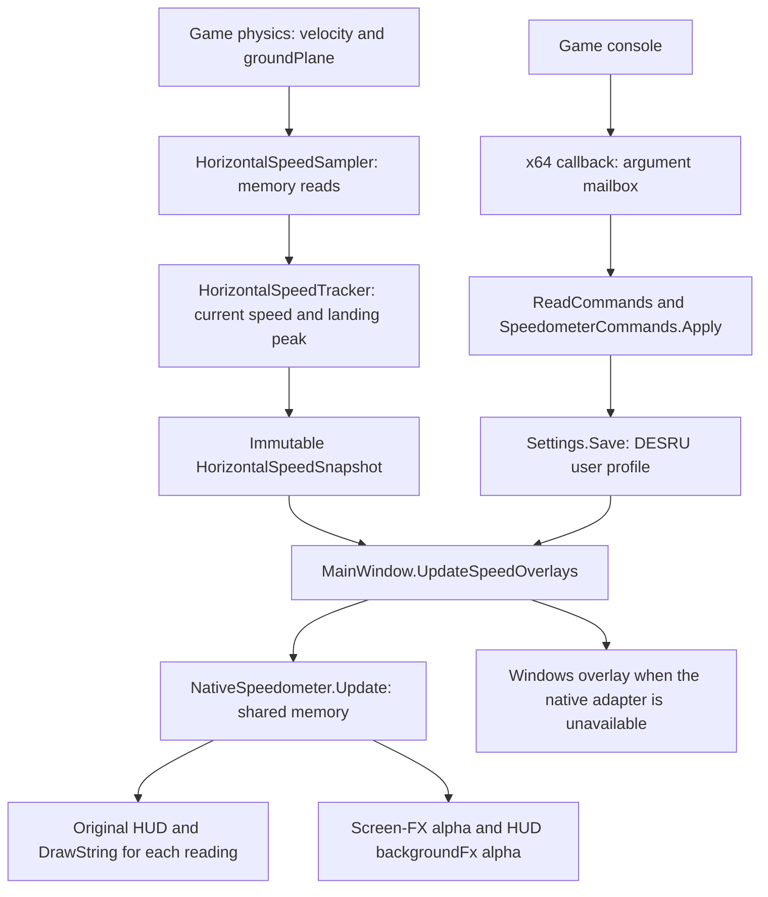

# Detailed DESRU Code Implementation Report

Current as of October 18, 2026. This report describes the final source state after all agreed changes, including RGB colors and low-health tint control. This public report omits local continuation notes and conversation history.

Workspace: `<workspace>`.
Original repository: https://github.com/bowsr/DESRU.
Base commit: `f78f602e80c4cd1ceb7c6ac306cb4531f111f3ab`; original DESRU version: 1.6.17.
This fork retains the upstream history. Source changes are published under the original GPL-3.0 license; see CREDITS.md.

## 1. Implemented behavior

DOOM Eternal displays current horizontal speed and the retained horizontal speed of the most recent landing impulse. The primary rendering path uses the game's own HUD, supporting exclusive fullscreen. A Windows overlay remains as a fallback.

Readings contain numbers with two decimal places, without captions or units. Before the first observed landing, the landing reading shows `--`; if the ground-contact layout is unknown, it shows `N/A`. Each reading has independent physical-pixel coordinates and an independent RGB color. A shared command controls text size. No new checkboxes were added to the DESRU interface.

`desru_lowhptintopacity` adjusts the opacity of both components of the red low-health effect. A value of 0 removes them; 100 restores their original opacity. The game continues to choose warning intensity according to health. This command does not modify health, thresholds, game events, or the rest of the HUD.

The user confirmed native fullscreen rendering, pixel coordinates, two decimal places, landing-impulse capture, complete removal/restoration of the low-health effect, and finally independent RGB colors and landing-speed visibility in the regular updated DESRU application. These are individual manual observations, not a claim of complete regression testing of every existing feature.

## 2. Architecture and data flow



There are three execution contexts. The main WinForms thread manages settings, attachment, and shared-memory updates. The speedometer worker only reads game physics and publishes snapshots. Generated x64 code runs inside the game: it calls the original renderer, captures console arguments, and makes targeted visual alpha adjustments. Game command callbacks do not call managed DESRU code.

Existing features retain their established execution paths: the trainer and its original speedometer, FPS/performance displays, resolution controls, hotkeys, macros, and firewall handling. The new functionality is connected through a partial window class and separate sampling/rendering classes.

## 3. Added and modified files


### 3.1. Added application files

| File | Responsibility and main methods |
| --- | --- |
| `DESpeedrunUtil/MainWindow.Overlays.cs` | `InitializeSpeedOverlays`, `UpdateSpeedOverlays`, `ReleaseSpeedOverlays`: integration, command processing, persistence, visibility, fallback, and cleanup. |
| `DESpeedrunUtil/Memory/HorizontalSpeedTracker.cs` | `Update`, `Reset`: horizontal magnitude, ground/air transitions, and the short landing-impulse window. No process-memory access. |
| `DESpeedrunUtil/Memory/HorizontalSpeedSampler.cs` | `SetContext`, `Sample`, `Snapshot`, `Dispose`: background reads, timing, and immutable snapshot publication. Also defines `HorizontalSpeedSnapshot`. |
| `DESpeedrunUtil/Overlay/NativeSpeedometer.cs` | `Attach`, `CreateState`, `Update`, `CreateReadings`, `CreateColors`, `ReadCommands`, `Dispose`: the C# side of the native adapter and protocol. |
| `DESpeedrunUtil/Overlay/NativeSpeedometerCode.cs` | `Code`, `Render`, `Command`: x64 instruction generation, relative branch fixups, registration/callbacks for seven commands, and separate rendering of both readings. |
| `DESpeedrunUtil/Overlay/SpeedometerCommands.cs` | Two `Apply` overloads and `InitializeIndependentPositions`: argument validation, settings updates, and one-time layout migration. |
| `DESpeedrunUtil/Overlay/SpeedometerText.cs` | `Format`: numeric formatting, placeholders, and length limits. Replaces the intermediate `SpeedometerPair.cs`. |
| `DESpeedrunUtil/Overlay/SpeedometerOverlay.cs` | `SpeedometerReading`, `UpdateDisplay`, `ReadingBounds`, `OnPaint`, `TryGetPhysicalViewport`: fallback window, colors, coordinate limits, and DPI handling. |
| `DESpeedrunUtil/Overlay/LowHealthTintTarget.cs` | `Update`, `Resolve`: identifies the current player's low/very-low-health FX and publishes the group handle and action indices. |
| `DESpeedrunUtil/Overlay/LowHealthTintCode.cs` | `CreateVignette`, `CreateHudControl`: machine code for the two final effect handlers. Older generators are retained to recognize earlier DESRU patches. |
| `DESpeedrunUtil/Overlay/LowHealthTintHook.cs` | `Attach`, `Install`, `AllocateNear`: screen-FX bridge verification/installation and upgrades of recognized older DESRU versions. |
| `DESpeedrunUtil/Overlay/LowHealthHudHook.cs` | Equivalent installation for the HUD. Its active handler resolves `lowHealth/backgroundFx` on the game thread. |
| `DESpeedrunUtil/Overlay/LegacyTintCleanup.cs` | `Restore`: recognizes and removes only verified earlier DESRU experimental bridges. |
| `DESpeedrunUtil/Properties/AssemblyInfo.cs` | `InternalsVisibleTo("DESRU.Tests")`, allowing internal classes to be tested without expanding the application's public API. |

### 3.2. Modified existing files

| File | Change |
| --- | --- |
| `DESpeedrunUtil/MainWindow.cs` | Calls `UpdateSpeedOverlays` before the trainer block in `UpdateTick`; releases speedometer resources before closing `Process` in `DisposeGameProcess`. |
| `DESpeedrunUtil/MainWindow.Events.cs` | Creates the fallback surface when the form loads; stops sampling/native updates and disposes the surface when closing. |
| `DESpeedrunUtil/Memory/MemoryHandler.cs` | Adds `_speedSampler`, `HorizontalSpeed`, `GroundContactSupported`, `ReadHorizontalSpeed`, and `StopSpeedSampler`. Updates sampling context after normal trainer reads. Explicitly clears `_velocityPtr` if the pointer chain cannot be resolved. |
| `DESpeedrunUtil/Define/Structs.cs` | Adds `KnownOffsets.GroundPlaneFromVelocity`; 0 means unknown. |
| `DESpeedrunUtil/Resources/offsets.json` | Adds `GroundPlaneFromVelocity: 136` for version 1.1. Corresponding offsets are not guessed for other versions. |
| `DESpeedrunUtil/Properties/Settings.settings` | Adds the 13 persistent properties listed below. |
| `DESpeedrunUtil/Properties/Settings.Designer.cs` | Adds their typed properties. |
| `DESpeedrunUtil/App.config` | Adds matching defaults, using multiline XML settings verified with the actual .NET configuration parser. |
| `DESpeedrunUtil/DESpeedrunUtil.csproj`, `Updater/Updater.csproj` | Adds `SkipBundleBuildEvents != true` conditions to existing PreBuild/PostBuild targets. Allows local builds without the normal output cleanup or missing bundle materials. Behavior without this property remains unchanged. The updater algorithm was not rewritten. |
| `README.md`, `HOWITWORKS.md` | Documents the feature and usage. |

### 3.3. Tests and documentation

| File | Contents |
| --- | --- |
| `tests/DESRU.Tests/DESRU.Tests.csproj` | Windows .NET 6 console test project referencing the application, without a separate test framework. |
| `tests/DESRU.Tests/Program.cs` | Speed logic, worker behavior, commands/colors, fallback UI, persistence, package validation, and diagnostic modes. |
| `tests/DESRU.Tests/NativeAdapterTests.cs` | Executes generated x64 code locally against controlled DrawString/HUD/AddCommand functions. |
| `tests/DESRU.Tests/LowHealthTintTests.cs` | Executes effect bridges locally; tests FX filtering, alpha at 0/50/100, expiry, and HUD baseline handling. |
| `docs/SPEEDOMETERS.md` | English usage instructions and technical notes. |
| `output/SPEEDOMETERS-RU.txt` | Short Russian guide included with the application package. |
| `docs/IMPLEMENTATION-REPORT-EN.md` | This complete English report. |

Diagnostic Python scripts, traces, intermediate builds, and reference materials are stored in the ignored `artifacts/` directory. They supported investigation but are not required to run the packaged application.

## 4. Game data access and speed calculation

Verified installation: `<game directory>/DOOMEternalx64vk.exe`.

| Item | Verified value |
| --- | --- |
| Investigated executable MD5 | `70426fc580f2c064cb618317fd1a9d5e` |
| SizeOfImage | `492113920`, or `0x1D551000` |
| Velocity pointer chain | `module + 80143112 → +0x1510 → +0x598 → +0x1D0 → +0x3F40` |
| `idHavokPhysics_Player.current` | `+0x3F28` |
| `playerPState_t.velocity` | `+0x18`, giving `+0x3F40` from the physics object |
| `playerPState_t.groundPlane` | `+0xA0`, giving `+0x3FC8` |
| Ground flag relative to velocity | `+0x88`, or 136 bytes |
| Physics / playerPState metadata | RVA `0x3A60530` / `0x3A604A0` |

The base velocity chain already existed in DESRU. The implementation adds a verified ground-contact flag. Version 1.1 uses a single 137-byte read covering three velocity floats and groundPlane. X/Y determine the speed magnitude; Z is checked for finiteness. The ground byte must be 0 or 1. A single ReadProcessMemory request reduces the separation between reads, but does not make the game physics state an atomic snapshot.

The formula is `sqrt((double)vx*vx + (double)vy*vy)`. Intermediate double arithmetic avoids premature float overflow. NaN, infinity, or a magnitude above float.MaxValue resets the readings.

`HorizontalSpeedSampler` is created when needed, provided master visibility is enabled and at least one reading is selected. The normal `MemoryTick` supplies the current address and permits reads outside loading/menu states. While active, the worker requests `timeBeginPeriod(1)` and reads with `Thread.Sleep(1)` between samples. While inactive, it releases the timer request, clears history, and waits for cancellation in 20 ms intervals. An address change also resets history. Context and `HorizontalSpeedSnapshot` are exchanged through Volatile; new immutable snapshots are published when values change.

`HorizontalSpeedTracker(8, 8)` follows these rules:

1. Attaching while the player is already standing does not create a landing.
2. While airborne, the tracker retains the time of the first airborne observation.
3. Returning to ground=true counts as a landing only after at least 8 ms airborne. This filters brief ground-flag glitches within physics updates.
4. The first contact captures current horizontal speed. For the next 8 ms, grounded samples may increase the retained maximum, accounting for contact and impulse being published in adjacent steps.
5. The value then remains unchanged until the next confirmed landing. Later walking acceleration and deceleration do not replace it.
6. Failed reads, invalid data, loading, an address change, or disabled sampling reset the state. With an unknown ground offset, current speed remains available but landing speed is not calculated.

This is frequent external sampling, not interception of every physics tick. Windows does not guarantee a 1 ms wake-up; a very short impulse can still be missed. On shutdown, `Dispose` cancels and joins the worker before the owner releases the game process handle. `timeEndPeriod` runs in finally.

## 5. Native game HUD rendering

The desktop overlay worked in borderless mode but did not provide the required exclusive fullscreen output. The final adapter calls the game's original DrawString.

| Item | RVA / location |
| --- | --- |
| Render pointer in idDebugHUDLocal vtable | `0x2608800`, slot 1 |
| Original HUD Render | `0x44BE70` |
| idRenderModelGui::DrawString | `0x5A5B90` |
| Virtual HUD width / height | `0x5A6090` / `0x5A6060` |
| Glyph width / height | `0x4F68560` / `0x4F68564` |
| commandSystem pointer | `0x3BDF8A8` |
| AddCommand | Vtable slot 3, offset 24 |

`Attach` checks image size, the expected Render pointer, signatures of the functions it uses, and valid font metrics. The MD5 identifies the investigated executable; the adapter does not calculate it on each attachment. Initial attachment allocates 8,192 bytes: a 4,096-byte RX code page and a 4,096-byte RW state page. One aligned eight-byte vtable pointer is replaced. The speedometer itself does not overwrite instructions inside game functions; tint control uses separate code hooks described below.

`NativeSpeedometerCode.Render` preserves the required nonvolatile registers and Windows x64 stack alignment, calls the original HUD, updates bookkeeping counters, registers missing commands, and calls DrawString separately for each enabled reading. Each call receives its own text and RGBA pointers. The generated renderer length is checked against the callback region starting at `0x500`.

`CreateReadings` prepares two 64-byte records. `SpeedometerText.Format` uses InvariantCulture and `0.00`; unusually large finite values use `0.00E+0` to fit the buffer. Text is ASCII, bounded to 31 bytes plus NUL. Each reading's unscaled width is its character count multiplied by the game glyph width.

Coordinates are converted independently:

```text
font_scale = size × 0.5
x_virtual = clamp(x_pixels × virtual_width / physical_width,
                  0, max(0, virtual_width − text_width × font_scale))
y_virtual = clamp(y_pixels × virtual_height / physical_height,
                  0, max(0, virtual_height − glyph_height × font_scale))
```

`TryGetPhysicalViewport` temporarily changes DPI awareness only for the calling thread during the relevant Win32 calls, then restores the previous context. The main DESRU UI's DPI behavior is unchanged. If viewport dimensions cannot be read, the native path falls back to 1920×1080. Oversized text can be clipped: clamping does not shrink the font. After migration, readings are not automatically separated; identical X/Y coordinates can overlap.

## 6. Game commands and argument exchange

Command index order is part of the protocol. Commands are registered through AddCommand with flag 2, CMD_NOCHEAT, without requiring cheats to be enabled.

| Index | Command | Arguments and behavior |
| --- | --- | --- |
| 0 | `desru_speedometer_show` | `0/1 [current\|landing]`. Without a target, changes master SpeedometersEnabled; 1 also enables current speed while preserving the landing preference. A targeted invocation changes only that individual flag, not master visibility. |
| 1 | `desru_speedometer_x_pos` | `pixels [current\|landing]`. X from 0 to Int32.MaxValue; fractional values use Math.Round. Without a target, sets X for both. |
| 2 | `desru_speedometer_y_pos` | The same rules, applied to Y. |
| 3 | `desru_speedometer_size` | `0.1…10`. Shared scale for both readings. The earlier optional current/landing target is accepted for compatibility but scale remains shared. |
| 4 | `desru_lowhptintopacity` | `0…100`, no target. Decimal percentages with a period are accepted. 0 removes the effect; 100 restores original opacity. |
| 5 | `desru_speedometer_showlanding` | `0/1`, no target. Selects landing visibility independently of the master switch. Does not enable master visibility by itself. |
| 6 | `desru_speedometer_color` | `R G B [current\|landing]`, three integer channels from 0 to 255. Without a target, changes both colors. |

Targets are case-insensitive. Scalar values use InvariantCulture and must be finite. RGB uses strict integer parsing with NumberStyles.None. Negative, fractional, incomplete, or above-255 channels and unknown targets are rejected before either color is modified. Invalid requests are logged and leave settings unchanged.

The old name `desru_show_speedometer` was replaced; no separate alias was added. Example:

```text
desru_speedometer_show 1
desru_speedometer_showlanding 1
desru_speedometer_x_pos 400 current
desru_speedometer_y_pos 600 current
desru_speedometer_x_pos 800 landing
desru_speedometer_y_pos 600 landing
desru_speedometer_size 2
desru_speedometer_color 255 0 0 current
desru_speedometer_color 0 255 0 landing
desru_lowhptintopacity 0
```

Each native callback receives idCmdArgs*, copies argc and up to two scalar arguments or four RGB arguments, and bounds each string to 31 characters plus NUL. Missing arguments are cleared. An atomic increment then publishes the sequence number. C# reads the mailbox, checks the sequence again, validates the argument count, applies the request, and saves settings. The adapter constructor records existing sequence values so reconnecting does not replay old requests.

A mailbox stores the latest request of each type, rather than a queue of all commands. Rapid repeated commands of one type between DESRU updates can replace intermediate requests. The protocol is intended for interactive configuration. The second sequence check helps reject changed reads but is not a formal guarantee of fully transactional exchange of all fields.

## 7. Persistent settings and migration

Persistence uses the existing `.NET ApplicationSettingsBase` and user `user.config`. Names and defaults are synchronized across Settings.settings, Settings.Designer.cs, and App.config. MainWindow calls Settings.Save after successful commands. No separate game configuration format was introduced.

| Setting | Type | Source default |
| --- | --- | --- |
| `SpeedometersEnabled` | bool | True |
| `CurrentSpeedOverlayEnabled` | bool | False |
| `LandingSpeedOverlayEnabled` | bool | True |
| `CurrentSpeedOverlayX`, `CurrentSpeedOverlayY` | int | 40, 600 |
| `LandingSpeedOverlayX`, `LandingSpeedOverlayY` | int | 200, 600 |
| `CurrentSpeedOverlayScale`, `LandingSpeedOverlayScale` | double | 1, 1 |
| `CurrentSpeedOverlayColor`, `LandingSpeedOverlayColor` | System.Drawing.Color | White, White |
| `SpeedometerPositionsVersion` | int | 0 |
| `LowHpTintOpacity` | double | 100 |

These are 13 individual properties. The size command writes both scale settings. `SpeedometerReading.DisplayColor` maps an empty Color to white; otherwise it uses opaque RGB. Native state stores channels divided by 255f, with alpha=1.

Source defaults leave current speed disabled until show1, while landing is selected by default. The prepared DESRU.dll.config uses the agreed initial layout: both enabled, current at (1172,740), landing at (1492,740), size 2, White RGB, and tint 100. Existing user.config values take precedence. Profile location depends on application location/identity; moving the executable can select a different profile. Updating the application did not reset the user's profile.

`InitializeIndependentPositions` performs a one-time version 0→1 migration. If both old positions match, landing X is shifted by ceil(160×currentScale), capped at Int32.MaxValue. Different positions are preserved. After version 1, intentionally matching coordinates are allowed. Percentage coordinates from the earliest test builds are not automatically converted; they must be entered again in pixels. The user has already done this.

## 8. Shared-memory layout (extended by DESRUS07 in section 14)

All offsets are relative to state. Values prefixed with `0x` are hexadecimal; other offsets are decimal.

| Offset | Size / purpose |
| --- | --- |
| 0 | int speed lease; 240 renews activity |
| 4 | int registration state: 0 none, 1 old four, 2 old five, 3 all seven |
| 8 | long HUD invocation count |
| 16 | float legacy shared text width, no longer used for the two texts |
| 20 | float glyph height |
| 24 | float zero, clamp lower bound |
| 32 | float[4] legacy white RGBA; current draws use 384/400 |
| 48 | ASCII[8], DESRUS06 |
| 56 / 60 | float physical viewport width / height |
| 64 / 128 | Two 64-byte reading records |
| 192 / 196 | int tint lease / float opacity coefficient |
| 200 | Actual idView pointer, for diagnostics |
| 208 / 216 | long earlier experimental counters |
| 224 | long active screen-vignette bridge invocation count |
| 232 | long target FX handle; -1 disables matching |
| 240 / 244 | int low / very-low action indices |
| 248 | long target FX match count |
| 256 / 260 | float last original / scaled screen-FX alpha |
| 280 / 288 | HUD element / SWF pointers for diagnostics |
| 296 / 304 | long all HUD calls / idHUD_LowWarning matches |
| 312 / 336 | Cached background sprite / display entry pointers |
| 320 / 324 | float baseline multiplicative / additive alpha for that entry |
| 328 / 332 | float last written multiplicative / additive alpha |
| 360 | long HUD backgroundFx match count |
| 384 / 400 | Two RGBA float[4] records, 16 bytes each |
| 0x400+i×0x80 | Command i mailbox |
| 0x800+i×0x100 | Command name, followed by its description at +64 |

A reading record contains: int enabled at +0, float X at +4, float Y at +8, float fontScale at +12, ASCII text[32] at +16, and float own unscaled text width at +48. Remaining bytes are reserved. The two records occupy 128 bytes and end before tint state.

A mailbox contains int sequence at +0, int argc at +4, including the command name, and 32-byte string slots from +16. The first six are read as 80 bytes each at a 128-byte stride. RGB starts at +0x700, is read as 144 bytes, and ends before the string block at +0x800. Argument slots and RGBA fields do not overlap tint state.

Code page: Render starts at +0; callbacks start at +0x500 with a 0x100 stride. The final RGB callback starts at +0xB00 and may occupy up to 0x500 bytes, since it is the last callback on the page. Generated lengths are checked before installation. Tint bridges have separate 4,096-byte pages; the marker at +0x300 contains an eight-byte version and the state pointer at +0x308.

## 9. Low-health red tint control

### 9.1. Why two handlers were required

The red effect is not a single generic renderer vignette. One component is the player's low/very-low-health screen FX. The other is the fullscreen background of `idHUD_LowWarning`, at `_root/lowHealth/backgroundFx`, including the game's low/critical timelines and pulsing.

Scaling only the first component weakened the effect but did not remove it completely at 0. The user clarified that the remainder was persistent health-dependent redness, not blood from recent damage. Temporarily setting r_vignette to 0 did not remove it; g_showHud 0 did. The final command controls both identified layers without disabling the complete HUD.

### 9.2. Resolving the target screen FX

`LowHealthTintTarget.Resolve` validates the player chain/vtable, declaration/vtable, an action array containing 1…256 entries, and a valid screen-FX slot. It finds type 23 actions with a single startCondition of 499 or 500. Only the current group handle and those two action indices are published.

| Field | Value |
| --- | --- |
| Player vtable | RVA 0x2984578 |
| FX declaration vtable | RVA 0x262A7B8 |
| player.curHealthScreenFXSlot | +0x25F60 |
| player.screenFXDecl / screenFX array | +0x37C78 / +0x37C80, stride 32 |
| Declaration runtime actions / count | +0xA0 / +0xA8 |
| Action size | 0x6C0 |
| type / startCondition list / count | +0x14 / +0x90 / +0x98 |
| FX_SCREEN_VIGNETTE / low / very-low | 23 / 499 / 500 |

Resolve runs at most once per 100 ms and completes before changing published state. An unchanged tuple does not need another write. On a change, the handle is invalidated first, then indices and the new handle are published. With fxSlot=-1, the previous handle is retained for fade-out only while it still belongs to the same player in one of four screenFX slots. Unverified structures disable targeting.

### 9.3. DESRUV04 screen-FX bridge

Hook location: RVA 0x174E365. Original instruction: `F3410F104610`, movss xmm0,[r14+0x10]. RDI points to idView, RBX relates to the layer field, and R14 points to output screenVignetteParms.

The handler checks the tint lease, a selected index from 0 to 7, the exact FX handle, and the low/very-low action index. Only a match changes output alpha to originalAlpha×scale. RGB and curve remain game-controlled. The original XMM0 value is restored for the following game branch that counts output records: at 0, the renderer must receive a transparent record rather than accidentally retaining an old layer. This bookkeeping fix distinguishes the final implementation from an earlier attempt.

Relevant structures: idView vignette buffer at +0x2DF8, eight entries of 0x50 bytes; layers at +0x3080, three entries of 0x48 bytes. The bridge preserves flags and touched general-purpose registers, then resumes after the complete replaced instruction. V01/V02/V03 are recognized/upgraded only when their code and state exactly match DESRU's own bridge.

### 9.4. DESRUH02 HUD bridge

Hook location: RVA 0x12AD3F3. Original bytes: `488B43104885C0`, mov rax,[rbx+0x10]; test rax,rax. Elements are filtered by vtable RVA 0x28EEB18. The current SWF is obtained through +0x10 and the root sprite through +0x4D0. Sprite display list/count are at +0x70/+0x78. Each entry is 0x40 bytes; child sprite is at +0x30, and the child's name pointer is at +0x18.

`CreateHudControl` resolves lowHealth, then backgroundFx in the current display lists on every invocation, with a maximum of 256 entries per level. Entry multiplicative alpha at +0x18 and additive alpha at +0x28 are scaled from a retained baseline. A different sprite/entry or new alpha written by the game causes the baseline to be captured again. Comparison against the last DESRU-written values prevents repeatedly multiplying already weakened values each frame.

At scale 0 both alpha coefficients become 0; at 100, or after lease expiry, the baseline is restored. Nested timelines/pulses are not replaced and RGB is not recolored. Resolution runs on the game's UI thread, without DESRU traversing previously cached sprite pointers externally. Flags, all touched general-purpose registers, and the whole XMM0 register are preserved. Original instructions are reproduced before continuing. This bridge makes no game-function calls.

### 9.5. Installation, compatibility, and earlier experiments

Tint hooks are installed lazily when opacity first drops below 100. At the normal default of 100, a new session does not need these two code patches. Attachment failure is logged separately from speedometer errors; tint lease is disabled and the coefficient returns to 1, leaving original rendering active.

For a rel32 JMP, installation searches for a free 4,096-byte page within ±0x70000000 of the hook site. It writes the bridge, sets the page to RX, and calls FlushInstructionCache. The game is suspended with NtSuspendProcess; expected bytes are checked again; page protection is temporarily changed; only whole instructions are replaced. Failures trigger a rollback attempt. Finally restores protection and calls NtResumeProcess. Pages that may remain jump destinations are not freed.

DESRUV04 and DESRUH02 markers include the shared-state pointer. Unverified third-party patches are not overwritten. Earlier experimental sites at RVA 0x1756076, 0x175614A, and 0x17501BD are not installed by the final path. `LegacyTintCleanup.Restore` recognizes only DESRU's own DESRUT01/02/03 by marker, state, branch destinations, and exact bridge bytes, then restores original instructions. Legacy encoders in LowHealthTintCode support recognition, not reinstallation of the unsuccessful approach.

## 10. Lifecycle, fallback, and support limits

Speed readings and tint have separate leases. DESRU regularly writes 240; the renderer decrements them as it is called. This measures HUD invocations, not milliseconds. If application updates stop, readings disappear and tint handlers return to original alpha during subsequent processing after expiry. If the game is not rendering, restoration waits for later calls. Normal Dispose immediately clears both leases.

On DESRU shutdown, game-side code and registered command callbacks deliberately remain allocated: the game may be executing them and its command table retains pointers. The OS releases memory when the game exits. Restarting DESRU recognizes its adapter and reuses state. S02/S03/S04/S05→S06 creates a new code page while preserving old callbacks/mailboxes. Old four-command state registers three additional commands; old five-command state registers two. Registration state 3 means all seven. The first command is renamed in place in the permanent string block; the live table confirmed the game retains that exact pointer.

Color/readings/dimension updates use several memory writes, not one atomic transaction. UI updates are periodic, not synchronized with every physics tick. A native Update failure clears leases through Dispose, blocks another attachment attempt in that game connection, and leaves the fallback path available. `_nativeAttachFailed` resets when the game connection is released.

The fallback window is layered, click-through, a tool window, nonactivating, and topmost. It covers the game's client area, draws the readings separately, and invalidates old dirty rectangles. A transparency key is selected from magenta/cyan/lime so it differs from both text colors. Magenta and cyan can therefore be used as visible RGB text colors. Focus, minimization, loading/menu state, and valid speed are considered before display.

Native behavior is verified for the identified DOOM Eternal 1.1 image. On unsupported builds, native commands and tint control are unavailable; the fallback uses saved settings and does not guarantee exclusive fullscreen output. An unknown ground offset produces N/A for landing speed. No new separate DLL must be copied into the game directory. New hooks modify process memory, not the game executable on disk.

## 11. Build, tests, and confirmed results

The verified environment uses Windows, .NET 6 Desktop, and full Visual Studio MSBuild. The project already depended on NetFwTypeLib COM, so dotnet build does not replace full MSBuild in this configuration. NuGet packages were restored during environment preparation.

```powershell
& 'C:\Program Files\Microsoft Visual Studio\18\Community\MSBuild\Current\Bin\MSBuild.exe' 'DOOMEternal Speedrun Utility.sln' /t:Build /p:Configuration=Release /p:Platform=x64 /p:SkipBundleBuildEvents=true /clp:ErrorsOnly /nologo
& 'C:\Program Files\Microsoft Visual Studio\18\Community\MSBuild\Current\Bin\MSBuild.exe' 'tests/DESRU.Tests/DESRU.Tests.csproj' /t:Build /p:Configuration=Release /p:Platform=x64 /p:SkipBundleBuildEvents=true /clp:ErrorsOnly /nologo
& 'tests/DESRU.Tests/bin/x64/Release/net6.0-windows/DESRU.Tests.exe'
& 'tests/DESRU.Tests/bin/x64/Release/net6.0-windows/DESRU.Tests.exe' --settings-write
& 'tests/DESRU.Tests/bin/x64/Release/net6.0-windows/DESRU.Tests.exe' --settings-read
& 'tests/DESRU.Tests/bin/x64/Release/net6.0-windows/DESRU.Tests.exe' --verify-package (Join-Path (Get-Location) 'output')
```

`SkipBundleBuildEvents=true` is needed for this local workflow because normal targets can clear output and expect missing bundle files. Persistence checks use a separate test-executable profile and reset it afterward, rather than modifying the regular DESRU profile. Game-memory diagnostics may require elevated permissions.

| Check | Latest confirmed result |
| --- | --- |
| Full solution and test project, Release x64 | Successful build |
| Main test run | 133 successful logic/UI/native execution checks |
| Persistence across separate launches | Six successful checks covering RGB, master show, coordinates, tint, and an existing setting |
| Prepared package | Actual Program.FileCheck and ConfigurationManager loading of DESRU.dll.config; both output and staging checked |
| Native adapter | Preserves original HUD; verifies ABI, both DrawString calls, separate RGBA, argc/strings, one-time registration, old4/old5→7, and lease behavior |
| Coordinates | Automated conversion for physical 1920×1080 and 3840×2160, independent width clamping; not a manual test on two monitors |
| Tracker/sampler | Speed, first contact, impulse window, brief ground glitch, reset, and actual background reads of local test memory |
| Tint | Filters other FX/actions/indices; tests 0/50/100, original bookkeeping, expiry, HUD baseline, and new game-written alpha |
| Regular DESRU with the live game | After replacing the old build, all seven names, DESRUS06/registration 3, and active leases were read back |

The first launch of the latest package exposed ConfigurationErrorsException on newly added single-line setting elements. Configuration files were reformatted as multiline XML, and the regular application then started successfully. `--verify-package` was extended with `OpenMappedExeConfiguration` and checks of new defaults: file presence alone does not validate configuration loading.


## 12. Delivery and continuation

Run `output/DESRU.exe` with all adjacent dependencies. Staging is `artifacts/release-lowhp`. The portable archive is `artifacts/DESRU-speedometers.zip`, excluding logs. Copies of reports, instructions, and context are included in output/docs and staging/docs. The archive is refreshed after documentation is synchronized.

Close an old DESRU instance before replacing binaries. A still-running five-command build once explained why the color command was unavailable. The supported reconnect did not require restarting the game. Prepare future builds separately; do not overwrite loaded DLLs. Do not run a temporary native helper alongside regular DESRU.


Investigation used the local executable's type tables and meath00k reference sources in artifacts. REA was not required for the final implementation. Read-only diagnostics include the test executable's `--inspect-lowhp` and `artifacts/live_commands.py`, `live_tint.py`, `live_swf_tree.py`, and `live_vignettes.py`. In this game's PE image, the main code was in .rsrc rather than .text. Avoid unbounded searches through very large generated reference files.

## 13. Appendix: exact source locations


| File | Method entry lines |
| --- | --- |
| `DESpeedrunUtil/MainWindow.Overlays.cs` | `InitializeSpeedOverlays`:10, `ReleaseSpeedOverlays`:18, `UpdateSpeedOverlays`:26 |
| `DESpeedrunUtil/Memory/HorizontalSpeedTracker.cs` | `Update`:16, `Reset`:51 |
| `DESpeedrunUtil/Memory/HorizontalSpeedSampler.cs` | `SetContext`:27, `Sample`:30, `Dispose`:67 |
| `DESpeedrunUtil/Overlay/NativeSpeedometer.cs` | `Attach`:32, `CreateState`:103, `Update`:131, `CreateReadings`:161, `CreateColors`:168, `ReadCommands`:190, `Dispose`:208 |
| `DESpeedrunUtil/Overlay/NativeSpeedometerCode.cs` | `Render`:30, `Command`:77 |
| `DESpeedrunUtil/Overlay/SpeedometerCommands.cs` | `Apply`:6, `InitializeIndependentPositions`:21, `Apply`:35 |
| `DESpeedrunUtil/Overlay/SpeedometerText.cs` | `Format`:5 |
| `DESpeedrunUtil/Overlay/SpeedometerOverlay.cs` | `UpdateDisplay`:34, `ReadingBounds`:60, `OnPaint`:72, `TryGetPhysicalViewport`:104 |
| `DESpeedrunUtil/Overlay/LowHealthTintTarget.cs` | `Update`:13, `Resolve`:26 |
| `DESpeedrunUtil/Overlay/LowHealthTintCode.cs` | `CreateHudControl`:5, `CreateVignette`:69 |
| `DESpeedrunUtil/Overlay/LowHealthTintHook.cs` | `Attach`:12, `Install`:29, `AllocateNear`:86 |
| `DESpeedrunUtil/Overlay/LowHealthHudHook.cs` | `Attach`:12, `Install`:29, `AllocateNear`:86 |
| `DESpeedrunUtil/Overlay/LegacyTintCleanup.cs` | `Restore`:10 |
| `DESpeedrunUtil/Memory/MemoryHandler.cs` | `ReadHorizontalSpeed`:457, `StopSpeedSampler`:463 |
| `tests/DESRU.Tests/Program.cs` | `Main`:15, `VerifySampler`:259 |
| `tests/DESRU.Tests/NativeAdapterTests.cs` | `Run`:14 |
| `tests/DESRU.Tests/LowHealthTintTests.cs` | `Run`:13 |

## Publication notes

The public fork disables upstream automatic update checks by default (`EnableUpstreamUpdates=False`) so an upstream update cannot replace these enhancements. Download fork releases manually. The release is an update archive for an existing official DESRU 1.6.17 installation; it does not redistribute game fonts, meath00k, or the freescroll executable. Source builds use the original project dependencies. Local paths, user profiles, logs, private continuation context, and PDBs are excluded.

## 14. Console command queries (DESRUS07)

All seven commands accept no arguments as a read-only query. They print exactly two lines:

```text
"desru_speedometer_size" is:"4" default:"1"
Set text size (0.1 to 10). Always applies to both speedometers.
```

The example assumes the source distribution default size of 1. A prepared installation whose configuration sets size 2 correctly reports default:"2". Unequal per-reading values are shown together, for example `is:"current=400 landing=800"`; equal values are collapsed into one. RGB uses three integers. Querying never changes or saves preferences.

`Overlay/SpeedometerCommandHelp.cs` formats current settings, reads application defaults from `typeof(Settings).Assembly.Location + ".config"` through an independent OpenMappedExeConfiguration, and provides English descriptions. Reading the Settings provider's shared cached section could accidentally report a saved color as its default; the independent on-disk configuration prevents this. Tests cover defaults both immediately after saving and after restarting the test process.

`ReadCommands` now accepts argc=1. MainWindow and the diagnostic helper route an empty argument array to help instead of Apply/Save. A bounded host queue of 32 responses publishes one response at a time, with text first and a ready flag last. The game HUD prints it and clears the flag afterward. The response uses state+416 for ready, +420 for constant `%s`, and +432 for a 576-byte NUL-terminated ASCII buffer, ending at +1008 before the command mailboxes. A message must fit completely; oversized messages are rejected.

The verified game print function is idLib::VPrintf at RVA `0x328C60`, entry signature `405556415441564157488DAC24207FFFFFB8E0810000`. The native adapter calls it on the game's HUD thread with channel=1, severity=1, format="%s", and a Windows x64 va_list containing the text pointer. It preserves the original HUD and prints even when meter visibility/lease is zero. Literal percent characters in messages are not interpreted as format strings. Native execution tests verify the ABI, one-time acknowledgement, and hidden-meter behavior.

The magic is now DESRUS07; DESRUS06 is accepted for migration, with the response region initialized before publishing the new renderer. Existing callbacks and command names are retained. Game hooks for low-health tint and speed calculations are unchanged. Final tests: 143 checks in the publication checkout (142 in the original worktree), plus 7 restart checks and the post-save default check. Earlier result counts in the report describe earlier snapshots.


## 15. Adaptive native integration and Steam validation (October 18, 2026)

Native rendering, console registration, console printing, glyph metrics and ground contact are now resolved from the installed executable by `Overlay/NativeGameLayout.cs`. PE sections, MSVC RTTI, unique instruction signatures and reflected game type metadata replace the previous 1.1-only native address selection. `NativeTintLayout.cs` records the resolved low-health layout. Runtime module size and original code bytes are checked before installation; unresolved or ambiguous layouts are rejected rather than patched with guessed addresses. Existing supported game memory roots remain managed by DESRU's version table. This is adaptive compatibility, not a guarantee for every past or future executable.

`MemoryHandler.cs` supplies the resolved contact offset and current player address. `MainWindow.Overlays.cs` forwards that address to the native adapter. `LowHealthTintTarget.cs` resolves the active screen-FX declaration, action list and low-health conditions using the layout metadata. Both identified low-health layers remain independently filtered: the player screen effect and HUD `_root/lowHealth/backgroundFx`.

`LowHealthTintCode.cs` adds the modern indexed vignette bridge. The Steam layout reads alpha through R14 + R15*4 + 0x8C0; the bridge preserves RDI/R14/R15 and the original XMM0 used by game bookkeeping while scaling only the selected output alpha. HUD SWF root is 0x18 on the tested Steam executable, versus 0x4D0 on 1.1. Buffer, enum, action-list and player-field offsets are resolved rather than shared blindly between builds. Hook ownership markers are DESRUV05 and DESRUH03; the shared renderer remains DESRUS07. Exact ownership checks, instruction-boundary patching, rollback and expiry restoration are retained.

Read-only resolution succeeded on installed 1.0, 1.1 and Steam 6.66 Rev 3.2 executables. Live native speedometers and console commands were confirmed by the user on 1.1 and Steam 6.66 Rev 3.2. The user also confirmed that low-health opacity 0/50/100 works on the current Steam build after transfer of both layers. Version 1.0 has resolution coverage only, not a live visual confirmation. No game executable on disk was modified.

Validation: 151 publication checks (150 in the original worktree, which lacks the fork updater-policy check), plus seven separate-process persistence checks. Native execution coverage includes the modern indexed alpha path at 0, 0.5 and 1, nonzero array index, preserved registers and original XMM0, expired lease restoration, and the modern HUD root. Full regression of every upstream feature and every game version is not claimed.
